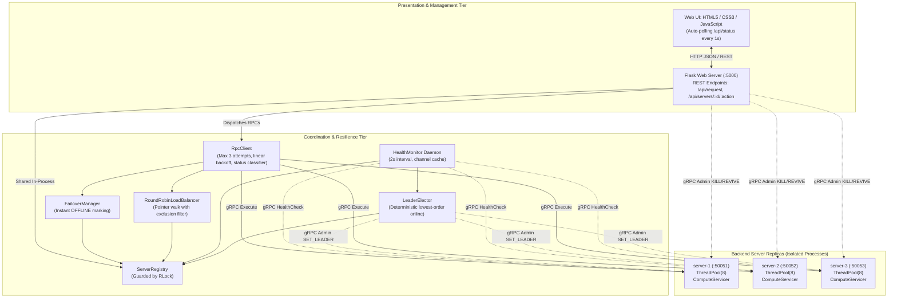
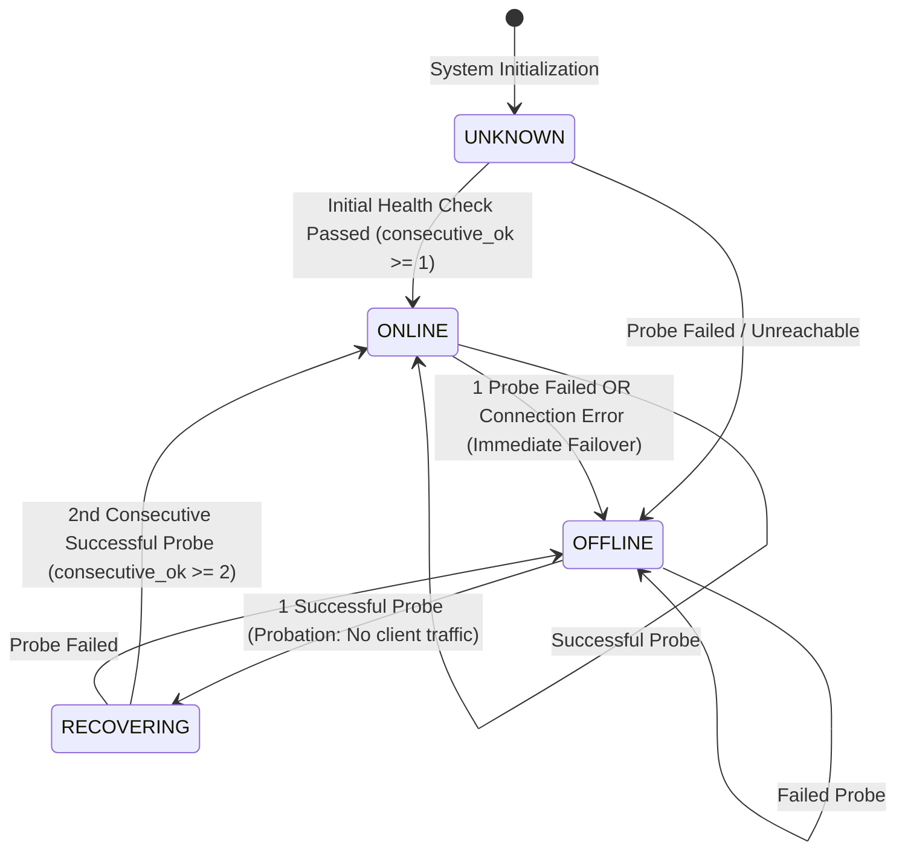
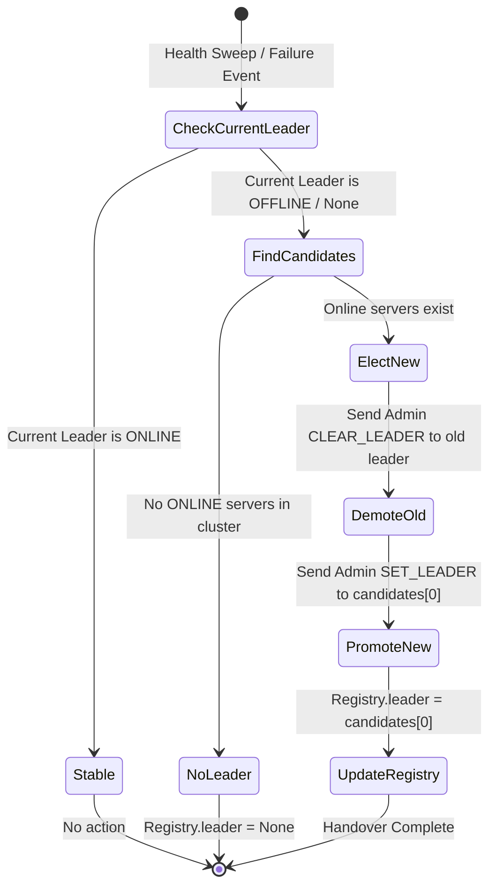

# Architecture Specification: Fault-Tolerant Distributed RPC Framework

An in-depth architectural blueprint of the Fault-Tolerant Distributed Remote Procedure Call (RPC) Framework, detailing component interactions, failure resilience models, protocol definitions, state machines, and Operating Systems concepts.

---

## Table of Contents

1. [Architectural Overview & System Goals](#1-architectural-overview--system-goals)
2. [Operating Systems Foundations](#2-operating-systems-foundations)
3. [System Topology & High-Level Architecture](#3-system-topology--high-level-architecture)
4. [Component Deep-Dive & Responsibilities](#4-component-deep-dive--responsibilities)
   - [4.1 Protocol Buffers & gRPC Service Layer](#41-protocol-buffers--grpc-service-layer)
   - [4.2 Backend Server Replicas (`servers/server.py`)](#42-backend-server-replicas-serversserverpy)
   - [4.3 Cluster State & Server Registry (`coordinator/cluster.py`)](#43-cluster-state--server-registry-coordinatorclusterpy)
   - [4.4 Round-Robin Load Balancer (`coordinator/load_balancer.py`)](#44-round-robin-load-balancer-coordinatorload_balancerpy)
   - [4.5 Failover Manager (`coordinator/failover_manager.py`)](#45-failover-manager-coordinatorfailover_managerpy)
   - [4.6 Health Monitor Daemon (`coordinator/health_monitor.py`)](#46-health-monitor-daemon-coordinatorhealth_monitorpy)
   - [4.7 Coordinator-Managed Leader Election (`coordinator/leader_election.py`)](#47-coordinator-managed-leader-election-coordinatorleader_electionpy)
   - [4.8 Fault-Tolerant RPC Client (`client/rpc_client.py`)](#48-fault-tolerant-rpc-client-clientrpc_clientpy)
   - [4.9 Web Observability & Control Dashboard (`dashboard/app.py`)](#49-web-observability--control-dashboard-dashboardapppy)
5. [Core State Machines & Formal Models](#5-core-state-machines--formal-models)
   - [5.1 Server Health Lifecycle State Machine](#51-server-health-lifecycle-state-machine)
   - [5.2 RPC Attempt & Retry Decision State Machine](#52-rpc-attempt--retry-decision-state-machine)
   - [5.3 Leader Election & Handover State Machine](#53-leader-election--handover-state-machine)
6. [Fault Tolerance & Error Classification Engine](#6-fault-tolerance--error-classification-engine)
   - [6.1 Error Classification Matrix](#61-error-classification-matrix)
   - [6.2 Backoff Strategy & Mathematical Formulation](#62-backoff-strategy--mathematical-formulation)
   - [6.3 Failover & Exclusion Set Strategy](#63-failover--exclusion-set-strategy)
7. [Communication Protocols & API Specifications](#7-communication-protocols--api-specifications)
   - [7.1 gRPC Service Definitions (`service.proto`)](#71-grpc-service-definitions-serviceproto)
   - [7.2 Dashboard REST API Endpoints](#72-dashboard-rest-api-endpoints)
8. [Concurrency, Synchronization & Threading Architecture](#8-concurrency-synchronization--threading-architecture)
9. [Failure Scenarios & Resilience Matrix](#9-failure-scenarios--resilience-matrix)
10. [Architectural Limitations & Production Evolution](#10-architectural-limitations--production-evolution)

---

## 1. Architectural Overview & System Goals

In distributed computing and operating systems, a single standalone server represents a **Single Point of Failure (SPOF)**. If that process crashes, experiences resource exhaustion, or suffers network partition, all client requests immediately fail, violating high availability and reliability guarantees.

The **Fault-Tolerant Distributed RPC Framework** solves this problem by deploying an active-active replica set of backend workers governed by an intelligent coordination and client proxy layer. The framework guarantees that:
- Client RPC requests are transparently balanced across healthy backend replicas.
- Transient network and application glitches are automatically absorbed via classified retries with linear backoff.
- Sudden node crashes trigger immediate failover and exclusion from the load-balancing rotation.
- Re-emerging servers undergo a probationary health check before rejoining active traffic.
- A single deterministic leader is continuously maintained across the replica set.
- All cluster activities, latencies, error states, and metrics are monitored and controllable in real time.

```
+-----------------------------------------------------------------------------------------+
|                                    CLIENT APPLICATION                                   |
|   client.call(operation, payload)                                                      |
+--------------------------------------------+--------------------------------------------+
                                             |
                                             v
+-----------------------------------------------------------------------------------------+
|                                  FAULT-TOLERANT RPC LAYER                               |
|  * Request ID Tracking    * Error Classifier    * Linear Backoff    * Attempt Telemetry |
+--------------------------------------------+--------------------------------------------+
                                             |
        +------------------------------------+------------------------------------+
        |                                                                         |
        v                                                                         v
+----------------------------------------------------+   +--------------------------------+
|                 COORDINATOR KERNEL                 |   |        BACKEND CLUSTER         |
|                                                    |   |                                |
|  - ServerRegistry: Shared thread-safe status & logs|   |  [Node 1] 127.0.0.1:50051      |
|  - RoundRobinLoadBalancer: Fair node dispatch      |===|    Execute | Health | Admin    |
|  - FailoverManager: Dead-node eviction             |   |  [Node 2] 127.0.0.1:50052      |
|  - HealthMonitor: 2s background heartbeats         |===|    Execute | Health | Admin    |
|  - LeaderElector: Deterministic coordinator rule   |   |  [Node 3] 127.0.0.1:50053      |
+----------------------------------------------------+   |    Execute | Health | Admin    |
                                                         +--------------------------------+
```

---

## 2. Operating Systems Foundations

The system directly embodies core OS principles within a distributed framework:

| Operating System Principle | Distributed Implementation in this Project | Code Location |
|:---|:---|:---|
| **Inter-Process Communication (IPC)** | Remote Procedure Call (gRPC over HTTP/2) enabling cross-process function execution across separate address spaces. | `proto/service.proto`, `client/rpc_client.py` |
| **Data Marshalling & Serialization** | Protocol Buffers (Protobuf v3) packing structured objects into compact, typed binary payloads (analogue of syscall argument packing). | `generated/service_pb2.py` |
| **Process Isolation** | Independent OS processes listening on separate kernel network ports (`:50051`, `:50052`, `:50053`), preventing memory corruption across replicas. | `servers/server.py` |
| **Multithreading & Concurrency** | Dedicated `ThreadPoolExecutor(max_workers=8)` in each server handling concurrent incoming requests without head-of-line blocking. | `servers/server.py` |
| **Mutual Exclusion & Critical Sections** | Re-entrant locks (`threading.RLock`) and mutexes (`threading.Lock`) guarding mutable registry state, metrics counters, and server state. | `coordinator/cluster.py`, `servers/server.py` |
| **CPU Scheduling & Fairness** | Round-robin dispatch algorithm cycling through active replicas, preventing starvation and distributing load evenly. | `coordinator/load_balancer.py` |
| **Periodic Daemons & Heartbeats** | Background daemon thread (`HealthMonitor`) waking up every 2.0s to probe system health, analogous to an OS watchdog or timer interrupt. | `coordinator/health_monitor.py` |
| **Bounded Waiting & Timeouts** | Explicit deadlines on every network interaction (`timeout=RPC_TIMEOUT`), preventing deadlock or indefinite hang. | `client/rpc_client.py`, `servers/server_config.py` |
| **Graceful Degradation & Fault Tolerance** | Dynamic failover routing requests away from failed nodes to surviving replicas without client interruption. | `coordinator/failover_manager.py` |
| **Distributed Mutual Exclusion** | Deterministic leader election designating a single master replica for coordinated tasks. | `coordinator/leader_election.py` |

---

## 3. System Topology & High-Level Architecture

The framework consists of three architectural tiers: **Presentation & Management Tier**, **Coordination & Client Tier**, and **Backend Replica Tier**.



---

## 4. Component Deep-Dive & Responsibilities

### 4.1 Protocol Buffers & gRPC Service Layer
The Interface Definition Language (IDL) file `proto/service.proto` establishes a strict contract between client and servers.

- **`ComputeService`**:
  - `rpc Execute (ComputeRequest) returns (ComputeResponse)`: Primary application RPC carrying `request_id`, `operation`, `payload`, and `attempt`.
  - `rpc HealthCheck (HealthRequest) returns (HealthResponse)`: Lightweight diagnostic probe returning health boolean, leader status, uptime, and cumulative handled request count.
  - `rpc Admin (AdminRequest) returns (AdminResponse)`: Control channel supporting runtime actions: `KILL`, `REVIVE`, `SET_LEADER`, `CLEAR_LEADER`, `SET_FAIL_RATE`, and `STATUS`.

### 4.2 Backend Server Replicas (`servers/server.py`)
Each backend runs as an independent OS process initiated via:
```bash
python servers/server.py --id server-1 --port 50051
```
- **Concurrency**: Bounded `ThreadPoolExecutor(max_workers=8)` prevents resource exhaustion attacks or unbounded thread proliferation.
- **Simulated Crash Mechanism**: Under `Admin(KILL)`, the internal flag `self.alive = False`. While dead, the process keeps running, but `Execute()` and `HealthCheck()` immediately return `grpc.StatusCode.UNAVAILABLE`. Crucially, `Admin(REVIVE)` continues to function, allowing remote revival without OS process re-spawning.
- **Transient Failure Injection**: `fail_rate` ($0.0 \le p \le 1.0$) randomly injects `grpc.StatusCode.ABORTED` errors.
- **Flaky Operation Logic**: Tracks request IDs in memory. For operation `flaky`, it rejects the first $N$ attempts with `StatusCode.ABORTED` before succeeding.

### 4.3 Cluster State & Server Registry (`coordinator/cluster.py`)
Acts as the **Single Source of Truth** for the entire cluster:
- **Thread Safety**: Governed by `threading.RLock()` to permit recursive locking within nested coordinator calls.
- **State Tracking**: Maintains an `OrderedDict` of `ServerState` objects containing:
  - Current status: `UNKNOWN`, `ONLINE`, `OFFLINE`, `RECOVERING`.
  - Telemetry: total requests, successes, failures, last error message, response latency, probe timestamp.
  - Leader assignment flag.
  - Consecutive probe counters (`consecutive_ok`, `consecutive_fail`).
- **Circular Event Log**: Maintains a `collections.deque(maxlen=120)` capturing timestamps, log levels (`INFO`, `WARN`, `SUCCESS`, `ERROR`), and human-readable event traces.

### 4.4 Round-Robin Load Balancer (`coordinator/load_balancer.py`)
- **Pointer Rotation Algorithm**: Maintains a current index pointer $P \in [0, N-1]$.
- **Skipping Inactive Nodes**: When a request arrives, the balancer iterates through offsets $k \in [0, N-1]$, testing candidate index $(P + k) \pmod N$.
- **Exclusion Filter**: If candidate server is currently `ONLINE` and not member of the `exclude` set (servers already tried during this request), it is selected, and pointer advances:
  $$P_{\text{next}} = (\text{candidate\_index} + 1) \pmod N$$
- If all available nodes are excluded or offline, returns `None`.

### 4.5 Failover Manager (`coordinator/failover_manager.py`)
- Intercepts connection-level exceptions (`StatusCode.UNAVAILABLE`, `StatusCode.DEADLINE_EXCEEDED`).
- Immediately invokes `registry.set_status(server_id, STATUS_OFFLINE, error)` and increments the global failover counter.
- Provides `pick(exclude)` helper delegating to the load balancer while enforcing exclusion of failed nodes.

### 4.6 Health Monitor Daemon (`coordinator/health_monitor.py`)
- Runs as a background daemon thread (`daemon=True`) executing every $T_{\text{interval}} = 2.0\text{s}$.
- Reuses persistent gRPC channels via `default_stub_factory()` to minimize TCP connection handshake overhead.
- Synchronously probes each server in sequence with a tight timeout ($T_{\text{timeout}} = 1.0\text{s}$).
- Drives the two-phase recovery state machine.
- Calls `leader_elector.ensure_leader()` at the end of every sweep.

### 4.7 Coordinator-Managed Leader Election (`coordinator/leader_election.py`)
- Employs a deterministic cluster rule: **The leader is the first `ONLINE` server according to configured cluster ordering (`server-1` < `server-2` < `server-3`)**.
- **Election Trigger**: Evaluated during every health sweep and immediately upon simulated leader failure.
- **Handover Procedure**:
  1. Issues `Admin(CLEAR_LEADER)` RPC to previous leader (best-effort).
  2. Issues `Admin(SET_LEADER)` RPC to newly promoted replica.
  3. Updates registry state and appends election event to the event log.

### 4.8 Fault-Tolerant RPC Client (`client/rpc_client.py`)
Encapsulates all resilience logic:
- Accepts high-level calls `call(operation, payload)`.
- Generates or tracks a persistent `request_id` across retry attempts.
- Enforces maximum retry budget ($\text{MAX\_ATTEMPTS} = 3$).
- Applies linear backoff delay:
  $$\Delta t = \text{RETRY\_DELAY} \times (\text{attempt} - 1) = 0.4\text{s} \times (\text{attempt} - 1)$$
- Classifies gRPC status codes into Connection, Transient, or Permanent categories.
- Accumulates detailed per-attempt telemetry records (`Attempt`).

### 4.9 Web Observability & Control Dashboard (`dashboard/app.py`)
A Flask web application hosting the coordinator kernel in-process:
- Serves responsive HTML5/CSS3 frontend.
- Polls `/api/status` every 1,000ms.
- Allows live RPC execution via interactive UI form.
- Provides interactive chaos injection buttons: Kill, Revive, Set Failure Rate, Kill Leader, Force Election, Reset Metrics.

---

## 5. Core State Machines & Formal Models

### 5.1 Server Health Lifecycle State Machine

Each server replica traverses a formal four-state lifecycle governed by consecutive health probe outcomes:



- **`UNKNOWN`**: Transient startup state before the first background sweep runs.
- **`ONLINE`**: Healthy, actively eligible for selection by the Load Balancer.
- **`OFFLINE`**: Unreachable or simulated crash. Completely excluded from the load balancer pool.
- **`RECOVERING`** (Probationary State): The server responded successfully to 1 probe, but is not yet trusted for live client traffic. Upon a second consecutive successful probe, it is promoted to `ONLINE`.

### 5.2 RPC Attempt & Retry Decision State Machine

```mermaid
flowchart TD
    Start([Client calls call()]) --> InitAttempt[attempt = 1, tried = set()]
    InitAttempt --> CheckAttempt{attempt <= MAX_ATTEMPTS?}
    
    CheckAttempt -- No --> FailRetryLimit[Result: FAILED RETRY_LIMIT]
    CheckAttempt -- Yes --> CheckBackoff{attempt > 1?}
    
    CheckBackoff -- Yes --> Sleep[Sleep RETRY_DELAY * attempt-1] --> PickServer
    CheckBackoff -- No --> PickServer[server = failover.pick exclude=tried]
    
    PickServer --> ServerAvailable{server found?}
    ServerAvailable -- No --> FallbackPick[server = failover.pick exclude=None]
    FallbackPick --> HasAnyServer{server found?}
    HasAnyServer -- No --> RecordNoServer[Record attempt: NO_SERVER] --> NextAttempt[attempt++] --> CheckAttempt
    HasAnyServer -- Yes --> MarkTried
    ServerAvailable -- Yes --> MarkTried[Add server to tried set]
    
    MarkTried --> ExecuteRPC[Execute RPC with timeout]
    ExecuteRPC --> StatusCheck{RPC Status?}
    
    StatusCheck -- OK --> Success[Result: SUCCESS]
    StatusCheck -- UNAVAILABLE / DEADLINE_EXCEEDED --> ConnError[Mark server OFFLINE Failover<br/>Record RETRY attempt] --> NextAttempt
    StatusCheck -- ABORTED / RESOURCE_EXHAUSTED / INTERNAL --> TransError[Server stays ONLINE<br/>Record RETRY attempt] --> NextAttempt
    StatusCheck -- INVALID_ARGUMENT / Other --> PermError[Result: FAILED PERMANENT]

    Success --> LogEvent[Update metrics & event log] --> End([Return RpcResult])
    FailRetryLimit --> LogEvent --> End
    PermError --> LogEvent --> End
```

### 5.3 Leader Election & Handover State Machine



---

## 6. Fault Tolerance & Error Classification Engine

### 6.1 Error Classification Matrix

The framework inspects every gRPC `StatusCode` and assigns strict operational semantics:

| gRPC Status Code | Category | Root Cause | System Action | Pool Impact |
|:---|:---|:---|:---|:---|
| `StatusCode.OK` | **Success** | Successful remote execution | Return result to caller | Server remains `ONLINE` |
| `StatusCode.UNAVAILABLE` | **Connection Failure** | Process crashed, port refused, simulated `KILL` | Mark server `OFFLINE`, record failover, retry immediately on alternate server | Evicted from active pool |
| `StatusCode.DEADLINE_EXCEEDED` | **Connection Failure** | Network latency spike, process frozen | Mark server `OFFLINE`, record failover, retry on alternate server | Evicted from active pool |
| `StatusCode.ABORTED` | **Transient App Failure** | Flaky error, concurrency conflict, transient rate | Retry request after linear backoff | Server remains `ONLINE` |
| `StatusCode.RESOURCE_EXHAUSTED` | **Transient App Failure** | Thread pool saturated, queue full | Retry request after linear backoff | Server remains `ONLINE` |
| `StatusCode.INTERNAL` | **Transient App Failure** | Transient internal server assertion | Retry request after linear backoff | Server remains `ONLINE` |
| `StatusCode.UNKNOWN` | **Transient App Failure** | Unclassified transient runtime error | Retry request after linear backoff | Server remains `ONLINE` |
| `StatusCode.INVALID_ARGUMENT` | **Permanent Error** | Bad payload (e.g. non-integer passed to `sum`) | Stop execution immediately; do **not** retry | Server remains `ONLINE` |
| `StatusCode.NOT_FOUND` | **Permanent Error** | Unknown operation or resource missing | Stop execution immediately | Server remains `ONLINE` |
| `StatusCode.UNIMPLEMENTED` | **Permanent Error** | Method not registered on servicer | Stop execution immediately | Server remains `ONLINE` |

### 6.2 Backoff Strategy & Mathematical Formulation

To prevent "thundering herd" problems and give recovering servers headroom:
$$\Delta t_k = \begin{cases} 0 & \text{if } k = 1 \\ \delta \times (k - 1) & \text{if } 2 \le k \le M \end{cases}$$
Where:
- $k$: Attempt counter ($1 \le k \le M$).
- $M = 3$: Maximum allowed attempts (`MAX_ATTEMPTS`).
- $\delta = 0.4\text{s}$: Base retry delay constant (`RETRY_DELAY`).

Timing progression:
- **Attempt 1**: Delay = $0.0\text{s}$ (instantaneous execution).
- **Attempt 2**: Delay = $0.4\text{s} \times 1 = 0.4\text{s}$.
- **Attempt 3**: Delay = $0.4\text{s} \times 2 = 0.8\text{s}$.
- Cumulative worst-case delay before giving up: $0.4 + 0.8 = 1.2\text{s}$ (excluding RPC timeouts).

### 6.3 Failover & Exclusion Set Strategy

When an attempt fails:
1. The client maintains an in-memory `tried` set initialized to $\emptyset$.
2. For attempt $k$, the selected server ID is appended: $\text{tried} \leftarrow \text{tried} \cup \{\text{server\_id}\}$.
3. If failure is a `CONNECTION_ERROR`:
   - `FailoverManager.mark_failed(server_id)` marks the server `OFFLINE`.
   - Global `failovers` metric increments.
4. The subsequent attempt requests a node excluding all previously tried nodes:
   $$\text{candidate} = \text{LoadBalancer.select}(\text{exclude}=\text{tried})$$
5. If all available servers have been tried once and the attempt budget is not exhausted, the exclude filter is cleared as a fallback in case a server recovered during backoff sleep.

---

## 7. Communication Protocols & API Specifications

### 7.1 gRPC Service Definitions (`service.proto`)

```protobuf
syntax = "proto3";
package ftrpc;

service ComputeService {
  rpc Execute     (ComputeRequest) returns (ComputeResponse);
  rpc HealthCheck (HealthRequest)  returns (HealthResponse);
  rpc Admin       (AdminRequest)   returns (AdminResponse);
}

message ComputeRequest {
  string request_id = 1;   // Stable UUID across retries
  string operation  = 2;   // echo | sum | square | slow | flaky | boom
  string payload    = 3;   // Argument string
  int32  attempt    = 4;   // Current attempt count (1..MAX_ATTEMPTS)
}

message ComputeResponse {
  string request_id    = 1;
  string server_id     = 2;
  string result        = 3;
  string status        = 4;   // "OK"
  string message       = 5;
  double processing_ms = 6;
  int32  attempt       = 7;
}

message HealthRequest { 
  string source = 1; 
}

message HealthResponse {
  string server_id        = 1;
  bool   healthy          = 2;
  bool   is_leader        = 3;
  int64  handled_requests = 4;
  double uptime_seconds   = 5;
}

message AdminRequest {
  string command = 1;  // KILL | REVIVE | SET_LEADER | CLEAR_LEADER | SET_FAIL_RATE | STATUS
  string value   = 2;
}

message AdminResponse {
  string server_id = 1;
  bool   ok        = 2;
  string message   = 3;
}
```

### 7.2 Dashboard REST API Endpoints

The Flask management tier exposes JSON endpoints consumed by the web UI:

| HTTP Method | Route | Description | Request Body | Response Payload |
|:---|:---|:---|:---|:---|
| `GET` | `/` | Web dashboard single-page interface | None | HTML Document |
| `GET` | `/api/status` | Cluster state snapshot & telemetry | None | `{"servers": [...], "totals": {...}, "leader": "server-1", ...}` |
| `POST` | `/api/request` | Submit RPC request batch through `RpcClient` | `{"operation": "echo", "payload": "hi", "count": 1}` | `{"ok": true, "results": [RpcResult, ...]}` |
| `POST` | `/api/servers/<id>/<action>` | Trigger simulated crash (`kill`) or recovery (`revive`) | None | `{"ok": true, "message": "...", "server_id": "server-1"}` |
| `POST` | `/api/servers/<id>/fail_rate`| Set transient failure probability | `{"rate": 0.5}` | `{"ok": true, "message": "..."}` |
| `POST` | `/api/leader/kill` | Kill current leader & trigger failover re-election | None | `{"ok": true, "old_leader": "...", "new_leader": "..."}` |
| `POST` | `/api/leader/elect` | Force immediate cluster leader re-evaluation | None | `{"ok": true, "leader": "..."}` |
| `POST` | `/api/reset` | Reset telemetry counters and load balancer pointer | None | `{"ok": true}` |

---

## 8. Concurrency, Synchronization & Threading Architecture

The framework operates under a multi-threaded, asynchronous concurrent execution environment:

```
+-----------------------------------------------------------------------------------------+
|                                    FLASK PROCESS (:5000)                                |
|                                                                                         |
|  [Main Thread]                   [HealthMonitor Daemon]         [Flask Request Pool]     |
|  Flask app.run()                 while True:                    Worker Thread 1, 2, ... |
|                                    _probe() every 2s            Handles /api/* requests |
|                                          |                                 |            |
|                                          +----------------+----------------+            |
|                                                           |                             |
|                                            v-----------------------------v              |
|                                            |      ServerRegistry         |              |
|                                            |  guard: threading.RLock()   |              |
|                                            +-----------------------------+              |
+-----------------------------------------------------------------------------------------+
```

1. **Re-entrant Locking (`RLock`) in Registry**:
   Because `ServerRegistry` methods may call other registry methods while modifying status or recording events, `threading.RLock()` prevents self-deadlock while ensuring atomic updates across worker threads.
2. **Channel Pool Caching**:
   `default_stub_factory()` maintains a synchronized map of addresses to `grpc.Channel` instances protected by `threading.Lock()`. Channels are reused across probes and client invocations, avoiding socket exhaustion (`TIME_WAIT` pileups).
3. **Non-blocking Background Probes**:
   The `HealthMonitor` runs as a daemon thread. Exceptions encountered during a probe (e.g. connection refused) are trapped and recorded as failures without terminating the thread loop.
4. **Server-side Worker Pool**:
   In `servers/server.py`, `grpc.server(futures.ThreadPoolExecutor(max_workers=8))` decouples network I/O from request execution, allowing up to 8 parallel RPCs per backend node.

---

## 9. Failure Scenarios & Resilience Matrix

| Failure Mode | Detection Point | Reaction Time | Primary Recovery Mechanism | System Outcome |
|:---|:---|:---|:---|:---|
| **Backend Crash (Physical or Simulated `KILL`)** | Client RPC execution OR Health Probe | Immediate on RPC ($< 5\text{ms}$); $\le 2.0\text{s}$ on idle probe | Server marked `OFFLINE`; Load balancer re-routes request to surviving node | **Zero client-visible failure**; request succeeds on alternate node |
| **Transient Glitch (`ABORTED`)** | Client RPC execution | Immediate | Linear backoff sleep ($0.4\text{s}$), request retried | Request succeeds on retry; server remains in active pool |
| **Server Latency Spike / Freeze** | Client RPC execution | Exact timeout ($3.0\text{s}$) | Deadline exceeded treated as connection failure; failover triggered | Client switches to healthy server; frozen node taken offline |
| **All Replicas Dead** | Client RPC execution | Immediate upon attempting all nodes | Returns `FAILED [NO_SERVER]` or `RETRY_LIMIT` after 3 attempts | Clean, structured error response; no unhandled exception or crash |
| **Leader Node Crash** | Health Monitor sweep or `/api/leader/kill` | $< 2.0\text{s}$ (or instant via API) | `LeaderElector` detects missing leader, promotes lowest indexed healthy node | Next available replica designated leader; cluster coordination maintained |
| **Server Reboot / Revive** | Health Monitor sweep | Within $2.0\text{s} - 4.0\text{s}$ | Enters `RECOVERING` on 1st probe; returns to `ONLINE` on 2nd probe | Server re-enters active round-robin rotation cleanly |

---

## 10. Architectural Limitations & Production Evolution

| Dimension | Current Project Design | Production Enterprise Architecture |
|:---|:---|:---|
| **Coordinator Topology** | In-process, single coordinator instance | Distributed consensus cluster (Raft / Paxos) or distributed service mesh (Envoy / Consul) |
| **Leader Election** | Deterministic rule (first online node); no quorum | Raft algorithm with terms, candidate voting, and distributed heartbeats |
| **State Persistence** | In-memory `OrderedDict` and `deque` | Distributed key-value store (etcd, Redis, or ZooKeeper) |
| **Security & Transport** | Insecure gRPC over plaintext HTTP/2 | Mutual TLS (mTLS), token-based authentication, RBAC authorization |
| **Load Balancing** | Unweighted Round-Robin | Least-connections, peak EWMA latency-aware, or consistent hashing |
| **Idempotency** | Request IDs logged, but operations executed repeatedly | Distributed idempotency store caching RPC results by `request_id` for exactly-once semantics |
| **Observability** | In-memory circular log & polling REST API | OpenTelemetry distributed tracing, Prometheus metrics scraping, and Grafana visualization |
