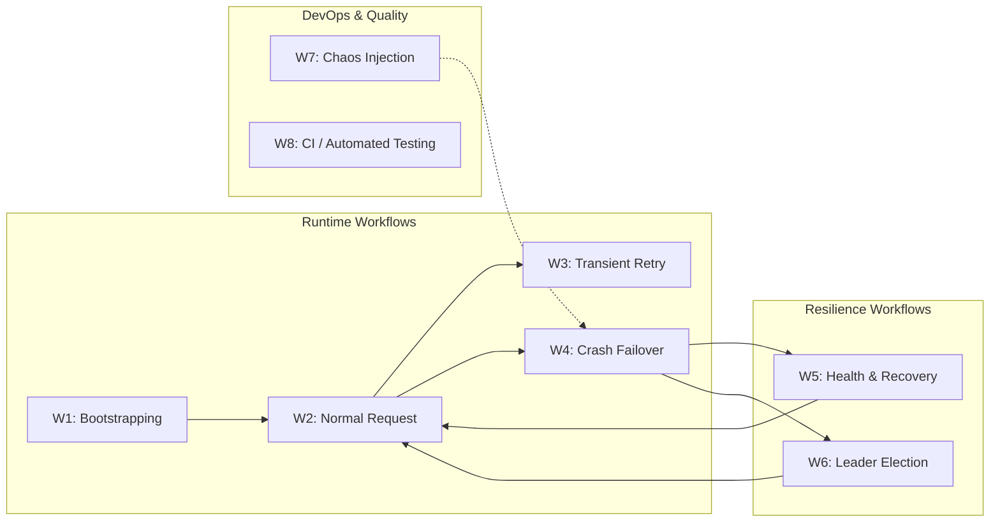
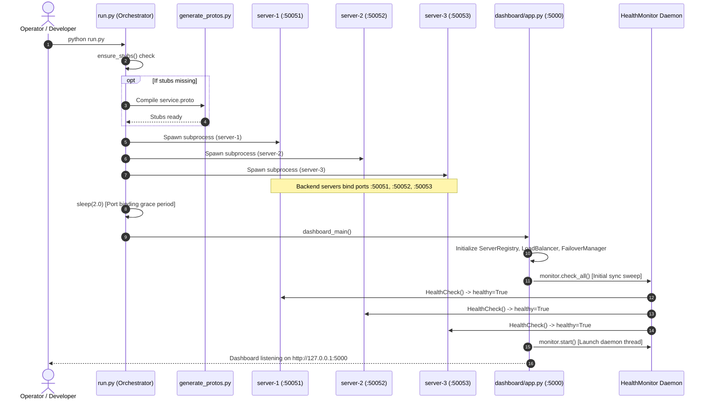
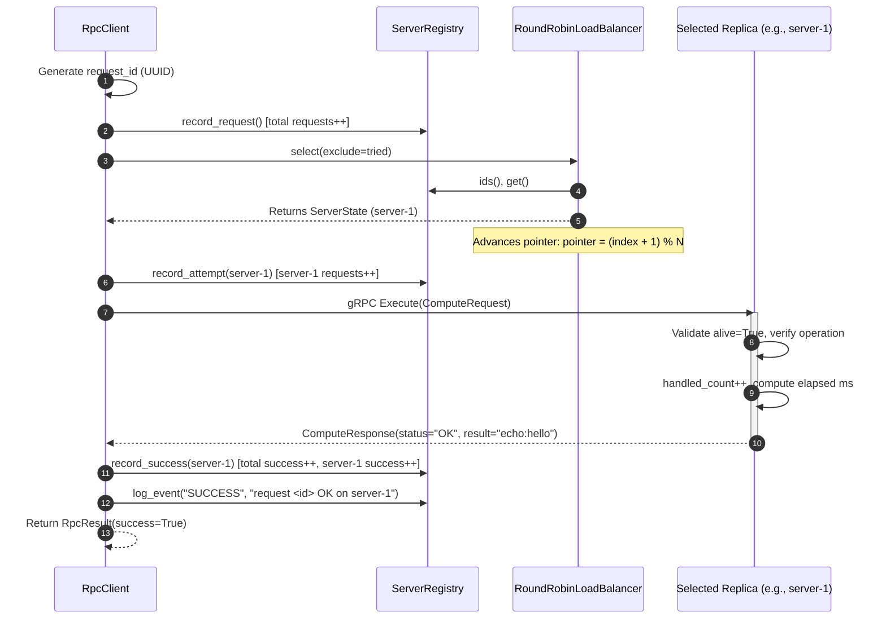
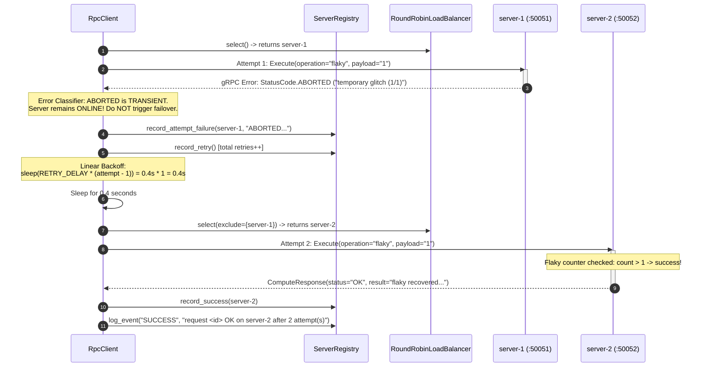
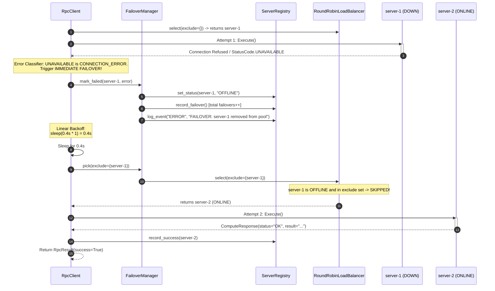
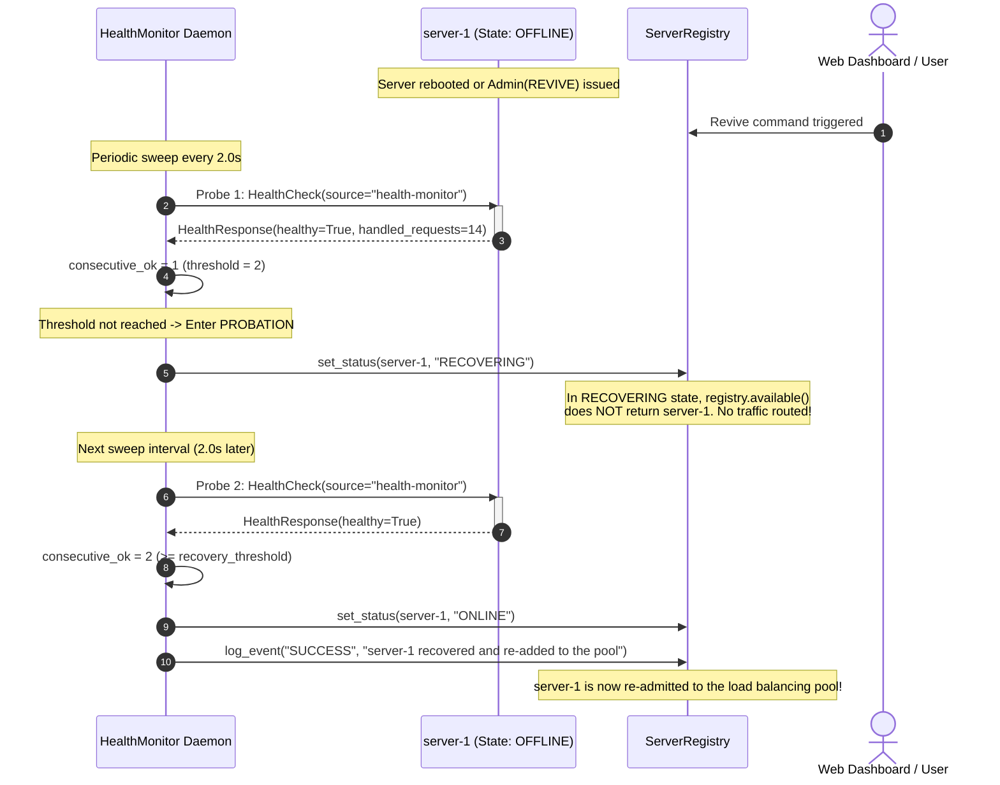
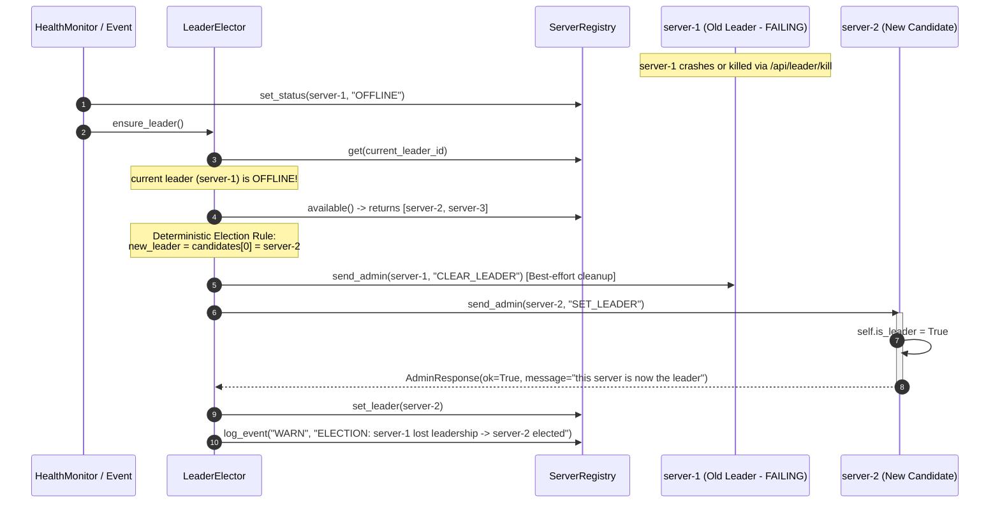

# System Workflows: Fault-Tolerant Distributed RPC Framework

This document details the step-by-step operational workflows, message flows, sequence diagrams, and lifecycle transitions of the Fault-Tolerant Distributed RPC Framework.

---

## Table of Contents

1. [Workflow Ecosystem Overview](#1-workflow-ecosystem-overview)
2. [Workflow 1: System Bootstrapping & Cluster Startup](#2-workflow-1-system-bootstrapping--cluster-startup)
3. [Workflow 2: Standard Client Request Lifecycle (Happy Path)](#3-workflow-2-standard-client-request-lifecycle-happy-path)
4. [Workflow 3: Transient Application Glitch & Linear Backoff Retry](#4-workflow-3-transient-application-glitch--linear-backoff-retry)
5. [Workflow 4: Node Crash, Immediate Detection & Dynamic Failover](#5-workflow-4-node-crash-immediate-detection--dynamic-failover)
6. [Workflow 5: Background Health Polling & Two-Stage Recovery](#6-workflow-5-background-health-polling--two-stage-recovery)
7. [Workflow 6: Leader Demotion & Handover Election](#7-workflow-6-leader-demotion--handover-election)
8. [Workflow 7: Chaos Engineering & Failure Injection](#8-workflow-7-chaos-engineering--failure-injection)
9. [Workflow 8: Continuous Integration & Automated Verification](#9-workflow-8-continuous-integration--automated-verification)

---

## 1. Workflow Ecosystem Overview

The framework operates across multiple coordinated workflows categorized into **Runtime Operations**, **Resilience & Recovery**, and **Development/CI**:



---

## 2. Workflow 1: System Bootstrapping & Cluster Startup

### Objective
Initialize all distributed backend worker processes, generate missing protobuf stubs, launch the in-process coordinator, initialize the health monitor daemon, and expose the Flask web dashboard.

### Sequence Diagram



### Execution Steps
1. **Stub Verification**: `run.py` attempts importing `proto_stubs`. If missing, `generate_protos.py` runs `grpc_tools.protoc`.
2. **Process Spawning**: Subprocesses for `server-1`, `server-2`, and `server-3` are launched using the current Python executable (`sys.executable`).
3. **Port Binding Grace Interval**: The orchestrator sleeps for 2.0 seconds, allowing servers to bind ports and instantiate thread pools.
4. **Coordinator Initialization**: In `dashboard/app.py`:
   - `ServerRegistry` initializes with 3 servers in `UNKNOWN` state.
   - `RoundRobinLoadBalancer` pointer is set to `0`.
   - `HealthMonitor` runs an initial synchronous `check_all()` sweep to discover live servers immediately.
   - `HealthMonitor.start()` launches the background polling thread.
5. **Dashboard Serving**: Flask starts listening on port `5000` with `threaded=True` and `use_reloader=False`.

---

## 3. Workflow 2: Standard Client Request Lifecycle (Happy Path)

### Objective
A client sends an RPC request (`operation="echo"`, `payload="hello"`), which is load-balanced, executed on a healthy backend, and logged in cluster metrics.

### Sequence Diagram



### Key Checkpoints
- **Pointer Movement**: Pointer shifts from `0` to `1`. The next request will target `server-2`.
- **Latency Measurement**: Both server processing time and full round-trip client time are measured with `time.perf_counter()`.
- **Atomicity**: Registry metrics updates are guarded by `RLock`.

---

## 4. Workflow 3: Transient Application Glitch & Linear Backoff Retry

### Objective
A request encounters a temporary server glitch (e.g. `StatusCode.ABORTED` from an overloaded worker or `operation="flaky"`). The client backs off linearly and retries until success without taking the healthy server offline.

### Sequence Diagram



### Mathematical Backoff Progression
- **Attempt 1**: No wait ($0.0\text{s}$). Fails with `StatusCode.ABORTED`.
- **Attempt 2**: Wait $0.4\text{s} \times 1 = 0.4\text{s}$. Succeeds.
- Total attempt records: 2. Server status: Both `server-1` and `server-2` remain `ONLINE`.

---

## 5. Workflow 4: Node Crash, Immediate Detection & Dynamic Failover

### Objective
A backend replica crashes (or is killed via simulated crash). The in-flight request detects connection loss, instantly removes the node from the active pool, and transparently succeeds on an alternate replica.

### Sequence Diagram



### Key Checkpoints
- **Transparent Recovery**: The calling client application experiences **no failure**; the response is successfully delivered on attempt 2.
- **Failover Metric**: The global `failovers` counter increments by 1.
- **Pool Exclusion**: `server-1` is immediately removed from the pool; subsequent requests skip `server-1` without waiting for the health monitor.

---

## 6. Workflow 5: Background Health Polling & Two-Stage Recovery

### Objective
The periodic health monitor detects a reviving server, places it on probation (`RECOVERING`), and restores it to active service (`ONLINE`) only after two consecutive successful probes.

### Sequence Diagram



### State Transition Summary
$$\text{OFFLINE} \xrightarrow{\text{1 good probe}} \text{RECOVERING (Probation)} \xrightarrow{\text{2nd good probe}} \text{ONLINE (Active)}$$

---

## 7. Workflow 6: Leader Demotion & Handover Election

### Objective
When the active leader node fails, the coordinator detects leadership loss, demotes the old leader, deterministically selects the next available node, and notifies the cluster via `Admin` RPC.

### Sequence Diagram



---

## 8. Workflow 7: Chaos Engineering & Failure Injection

### Objective
Operators inject deterministic failure modes through the web dashboard or CLI to test fault tolerance in real time.

### Available Injection Actions & Handlers

| Action | API Trigger | Internal Mechanism | Observed Behavior |
|:---|:---|:---|:---|
| **Kill Node** | `POST /api/servers/<id>/kill` | Sends `Admin(KILL)` RPC; marks `OFFLINE` | Server rejects `Execute` with `UNAVAILABLE`. Requests reroute to remaining nodes. |
| **Revive Node** | `POST /api/servers/<id>/revive` | Sends `Admin(REVIVE)` RPC; runs immediate sweep | Clears flaky counters, initiates two-stage recovery probe. |
| **Transient Error Rate** | `POST /api/servers/<id>/fail_rate` (`rate=0.5`) | Sends `Admin(SET_FAIL_RATE, 0.5)` | Injects `StatusCode.ABORTED` randomly with 50% probability, forcing client retries. |
| **Kill Leader** | `POST /api/leader/kill` | Sends `Admin(KILL)` to leader; invokes `force_reelection()` | Current leader drops, next online server promoted immediately with zero downtime. |
| **Simulate Permanent Error** | UI form: operation `boom` | Executed directly on servicer | Returns `StatusCode.INVALID_ARGUMENT`. Client terminates after 1 attempt. |
| **Simulate Slow Node** | UI form: operation `slow`, payload `4` | `time.sleep(4.0)` on servicer | Exceeds `RPC_TIMEOUT = 3.0s`. Client catches `DEADLINE_EXCEEDED` and fails over. |

---

## 9. Workflow 8: Continuous Integration & Automated Verification

### Objective
Ensure cross-platform compatibility, verify protobuf stub generation, and execute all 17 unit test cases on every code commit and pull request.

### CI/CD Workflow Pipeline

```mermaid
flowchart TD
    Push([Push / PR to main]) --> Matrix[Matrix Setup: Ubuntu & Windows<br/>Python 3.10, 3.11, 3.12, 3.13]
    
    subgraph Job1 ["Job: Test Matrix"]
        Matrix --> Checkout[actions/checkout@v4]
        Checkout --> SetupPy[actions/setup-python@v5]
        SetupPy --> Dependencies[pip install -r requirements.txt]
        Dependencies --> GenProto[python generate_protos.py]
        GenProto --> VerifyStubs{Stubs Exist?}
        VerifyStubs -- Yes --> RunUnitTests[python -m unittest discover -s tests -v]
        VerifyStubs -- No --> FailJob[Fail Build]
        RunUnitTests --> TestPass{All 17 Tests Pass?}
        TestPass -- Yes --> Job1Success[Job Success]
        TestPass -- No --> FailJob
    end

    subgraph Job2 ["Job: Smoke Test"]
        Job1Success --> SpawnCluster[Spawn 3 Background Servers]
        SpawnCluster --> RunCLIClient[Execute CLI Client against live ports]
        RunCLIClient --> VerifyOutputs[Verify echo, sum, square RPCs]
        VerifyOutputs --> Job2Success[CI Green Pass]
    end
```

### Test Suite Execution Command
```bash
python -m unittest discover -s tests -v
```

### Covered Test Matrix (17 Automated Tests)
1. `test_round_robin_cycles_through_all_servers`: Validates exact 1-2-3-1-2-3 distribution.
2. `test_offline_servers_are_skipped`: Validates skipping crashed nodes.
3. `test_recovering_server_is_not_in_the_pool`: Validates isolation during probation.
4. `test_select_returns_none_when_everything_is_down`: Validates graceful degradation when all nodes crash.
5. `test_requests_are_distributed_evenly`: Validates load uniformity across healthy workers.
6. `test_retries_until_success`: Validates retry loops for transient glitches.
7. `test_stops_after_retry_limit`: Validates retry budget enforcement ($\text{MAX\_ATTEMPTS} = 3$).
8. `test_permanent_error_is_not_retried`: Validates immediate termination on bad input.
9. `test_transient_failure_does_not_take_server_offline`: Validates node retention on `ABORTED`.
10. `test_request_is_redirected_to_a_healthy_server`: Validates dynamic failover on `UNAVAILABLE`.
11. `test_failed_server_leaves_the_pool_for_later_requests`: Validates eviction from active rotation.
12. `test_failure_when_no_server_is_available`: Validates graceful error when all nodes fail.
13. `test_detects_a_dead_server`: Validates background health probe detection.
14. `test_recovery_goes_through_recovering_then_online`: Validates two-stage state transition.
15. `test_elects_first_online_server`: Validates deterministic leader selection.
16. `test_new_leader_elected_when_leader_dies`: Validates automatic leader failover.
17. `test_no_leader_when_all_servers_are_down`: Validates empty leader handling.
